# Routine Progress

**Your day is a stock.** An Obsidian plugin that turns your daily routine into numbers you can see move.

Checkboxes say whether you did something. They don't say how much, and they don't show the trend. This plugin gives every habit points, adds them up per category, and draws your days as a line that goes up on good days and down on bad ones.

## The idea

- **Points, not checkboxes.** Every habit earns points. Counted habits (pages, reps, hours) earn points per unit, so more effort shows as more progress.
- **Your day is a stock.** Your routine has a price that starts at 100. A good day moves it up, a weak day moves it down, a skipped day pulls it down. Consistency compounds.
- **Sick days are fair.** Tick "Sick day" and the price holds flat. Being ill shouldn't look like failure.
- **It's a game.** XP, levels, a daily minimum to keep the chain alive, and streaks per habit.
- **It lives on your Lock Screen.** The plugin saves your graph as `progress-wallpaper.png`, ready to set as a phone wallpaper.

## Try it

1. Download this repo.
2. Open `example-vault` as a vault in Obsidian.
3. Turn on community plugins when Obsidian asks.
4. Open `Progress.md`.

Today's note is created from `Templates/Daily.md` automatically.

## Use it in your own vault

Copy `main.js` and `manifest.json` into `<your vault>/.obsidian/plugins/routine-progress/`, then turn the plugin on in Settings → Community plugins. Also copy `Templates/Daily.md` and `Progress.md` from the example vault.

Daily notes live in `Daily/` and are named `YYYY-MM-DD.md`.

## Make it yours

Your habits and their points are set in `POINTS` at the top of `main.js`. Each `##` heading in the daily note is a category. Edit both to match your routine, then reload the plugin.

## License

MIT
